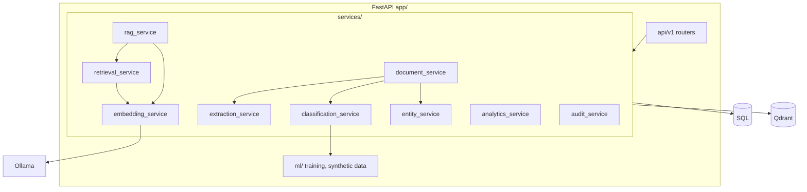

# Architecture

Modular monolith: one FastAPI process (plus an optional separate worker running the same code). No microservices — nothing here needs independent scaling.

## Processing pipeline
`uploaded → queued → extracting → chunking → embedding → indexed → classifying → completed` (or `failed`). Each transition is stored as a `processing_events` row (shown on the document page). Jobs live in `processing_jobs`; a worker claims one with an atomic `UPDATE … WHERE status='pending'` so multiple workers cannot double-process. If embedding/Qdrant is unavailable, text is still extracted, chunked, classified and keyword-searchable; the document is marked `failed` with an explicit message and the job is retried (≤ `MAX_JOB_ATTEMPTS`) or can be reprocessed manually.

## PostgreSQL ↔ Qdrant consistency
These are not atomic. Rules: chunk rows in SQL are the source of truth; each Qdrant point id equals the chunk id; (re)processing deletes the document's vectors before upserting (idempotent); delete removes vectors → file → rows and, if any step fails, keeps the row with `deletion_state='delete_failed'` so it is visible and retryable. Collections are named `<prefix>_<embedding-model>_<dimensions>` so incompatible embeddings never mix; changing the embedding model creates a new collection and requires reprocessing documents.

## Authorization model
One role per user: `admin` (all capabilities), `analyst` (upload/search/ask/analytics), `reviewer` (review queue, entity corrections). Documents are visible to their owner and to admins; other users get **404** (not 403) so existence is not leaked. Search/RAG filter by owner in the Qdrant query *and* re-check ownership against the database. Conversations are private to the owner, including from admins. Enforcement is in FastAPI dependencies (`api/deps.py`), tested at the API layer.

## Database schema (SQLAlchemy models in `app/models`, migration `alembic/versions/0001_initial_schema.py`)
`users` · `documents` (unique `(owner_id, sha256)`) · `document_chunks` (unique `(document_id, chunk_index)`) · `processing_jobs` · `processing_events` · `model_versions` · `classification_predictions` (machine output, `is_current`, `review_status`) · `verified_classifications` (human label, one per document) · `review_records` · `extracted_entities` · `conversations` · `chat_messages` (citations JSON) · `audit_events` · `search_logs` · `evaluation_runs`. IDs are string UUIDs; FKs cascade from `documents`; indexes on owner, status, timestamps, action.

## RAG flow
authenticate → owner-scoped hybrid retrieval (keyword fallback if embeddings are down, reported to the UI) → evidence gate (`MIN_KEYWORD_OVERLAP` or `MIN_SEMANTIC_SCORE`; below → fixed “insufficient evidence” reply **without calling the LLM**) → sanitize chunks and drop injection-like ones → prompt with aliases `E1..En` → strict JSON output → citations mapped back to real chunks → no valid citation ⇒ insufficient evidence. See `rag_service.py` header for the full layered-defence list.
