# InfoMind AI Enterprise: the whole project explained

This file explains what the project is, how it is built, and how data moves through it, with a picture for every important flow. It is written so that someone who has not seen the code can follow it. Everything here was checked against the source code on 2026-10-29; where something is not built, not tested or only partly true, it says so.

**The pictures** are in [images/](images/). Their sources are plain-text Mermaid files in [diagrams/](diagrams/) (GitHub and VS Code's Markdown preview with a Mermaid extension draw them too). The PNGs were rendered from those files with Mermaid 11.4.0 in headless Edge. Colour code used in the flowcharts: **amber** = a decision, **green** = a good outcome, **red** = a failure or refusal.

## Contents
1. [The project in one minute](#1-the-project-in-one-minute)
2. [The big picture](#2-the-big-picture)
3. [Who can do what (roles)](#3-who-can-do-what-roles)
4. [The website: what a visitor and a user sees](#4-the-website-what-a-visitor-and-a-user-sees)
5. [Data flow 1: signing in and every request](#5-data-flow-1-signing-in-and-every-request)
6. [Data flow 2: uploading and processing a document](#6-data-flow-2-uploading-and-processing-a-document)
7. [Data flow 3: classification and human review](#7-data-flow-3-classification-and-human-review)
8. [Data flow 4: searching](#8-data-flow-4-searching)
9. [Data flow 5: the AI assistant (answers with citations)](#9-data-flow-5-the-ai-assistant-answers-with-citations)
10. [Entities, analytics, audit and evaluation](#10-entities-analytics-audit-and-evaluation)
11. [The database](#11-the-database)
12. [The API at a glance](#12-the-api-at-a-glance)
13. [The frontend in detail](#13-the-frontend-in-detail)
14. [Security design](#14-security-design)
15. [Configuration](#15-configuration)
16. [Running it: locally, in Docker, and live](#16-running-it-locally-in-docker-and-live)
17. [Tests and what has been verified](#17-tests-and-what-has-been-verified)
18. [Known limitations](#18-known-limitations)
19. [Where to find things in the code](#19-where-to-find-things-in-the-code)
20. [Glossary](#20-glossary)

---

## 1. The project in one minute

**InfoMind AI Enterprise** is a web application for organising, finding and questioning a collection of documents.

- You **upload** documents (PDF, Word, Excel, CSV, plain text).
- The system **reads** them, cuts them into short passages ("chunks"), and **indexes** the passages so they can be searched by words *and* by meaning.
- A small machine-learning model **suggests a category** for each document (for example "Finance and Procurement"). When the model is unsure, a human **reviewer** decides.
- You can **search** the collection, or **ask a question** and get an answer that is built only from your documents and shows the passages it came from. If the documents do not contain the answer, it says so.
- **Dashboards** and an **audit log** show what is happening, and **roles** control who may do what.

It is an **educational, research-oriented prototype**. It must be used with synthetic or public data only. It is not certified for classified, restricted, personal or operational use, and nothing in it claims otherwise.

Technology, in one table:

| Layer | What is used | Why it is there |
|---|---|---|
| Web app | React 18, TypeScript, Vite 5, Tailwind CSS, TanStack Query, React Router 6, react-hook-form + zod, Recharts | The screens people use |
| API | Python, FastAPI, SQLAlchemy 2, Alembic, Pydantic | Business rules, security, all data access |
| Database | PostgreSQL 16 (SQLite for quick local use and tests) | Users, documents, chunk text, jobs, labels, chats, audit |
| Vector search | Qdrant | Finding passages by meaning |
| Classifier | scikit-learn: TF-IDF + Logistic Regression or Linear SVM | Suggests a category |
| Language models | Ollama running on your own computer: `llama3.2:3b` by default (`llama3.1:8b` measured better), `nomic-embed-text` for embeddings | Answers and meaning-based search |
| File reading | PyMuPDF (PDF), python-docx, openpyxl | Turning files into text |
| Hosting (live copy) | Vercel for the web app, Render for the API and database | A public demo |

---

## 2. The big picture

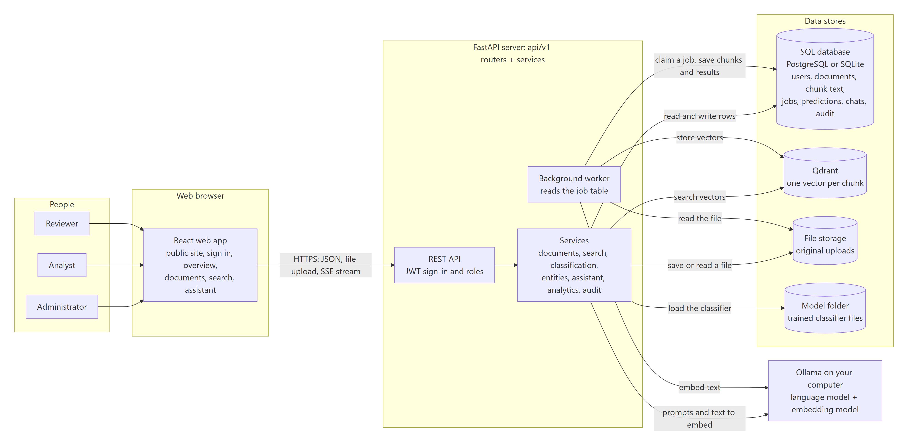

How to read it, left to right:

1. **People** use the **React web app** in a browser.
2. The browser talks to the **FastAPI server** over HTTPS. It sends JSON, file uploads, and (for the assistant) receives a live text stream (Server-Sent Events).
3. Inside the server, thin **routers** (`backend/app/api/v1/`) check who you are and what you may do, then call **services** (`backend/app/services/`) that hold the real logic.
4. Services use four **data stores**:
   - the **SQL database**: the source of truth for users, documents, the *text of every chunk*, jobs, predictions, conversations and the audit log;
   - **Qdrant**: one vector (a list of numbers describing meaning) per chunk, used only for meaning-based search; it can always be rebuilt from the chunk text in SQL;
   - **file storage**: the original uploaded files, stored under random names outside any publicly served folder;
   - the **model folder**: the trained classifier files.
5. **Ollama** (on your computer) provides two things: an *embedding model* that turns text into vectors, and a *language model* that writes answers. The browser never talks to Ollama; only the server does.
6. A **background worker** reads a job table in the database and does the slow work of processing uploads. It can run inside the API process or as a separate container; both run the same code.

**Design choice: a modular monolith.** There is one backend program, not many small services, because nothing here needs to scale independently. The code is still split by responsibility (routers, services, models, ML) so each part can be understood alone.

---

## 3. Who can do what (roles)

Each user has exactly one role. **Administrator** passes every role check.

| Capability | Analyst | Reviewer | Administrator |
|---|:-:|:-:|:-:|
| Upload, reprocess, reclassify, delete own documents | yes | no | yes |
| List and open documents | own only | own only | all |
| Keyword, semantic and hybrid search | yes | no | yes |
| Ask the AI assistant | yes | no | yes |
| Overview, analytics, classification page (view metrics, try a prediction) | yes | no | yes |
| Review queue: confirm or correct categories; remove a wrongly detected entity | no | yes | yes |
| Train a new classifier model | no | no | yes |
| Audit log; list users and change roles | no | no | yes |
| Settings page (model and system status) | everyone signed in | | |
| Own chat conversations | owner only (**even administrators cannot read others'**) | | |

Important details, all enforced **on the server** (the menu hiding things in the browser is only a convenience):

- A document that belongs to someone else gives **404 Not Found**, not "forbidden", so its existence is not revealed.
- Search and the assistant filter by owner **inside the Qdrant query and again against the SQL database**. The vector store is never the only gatekeeper. Administrators search everything (a stated policy choice; there is no per-document sharing yet).
- Self-registration creates an **analyst**. An administrator cannot remove their own admin role.

---

## 4. The website: what a visitor and a user sees

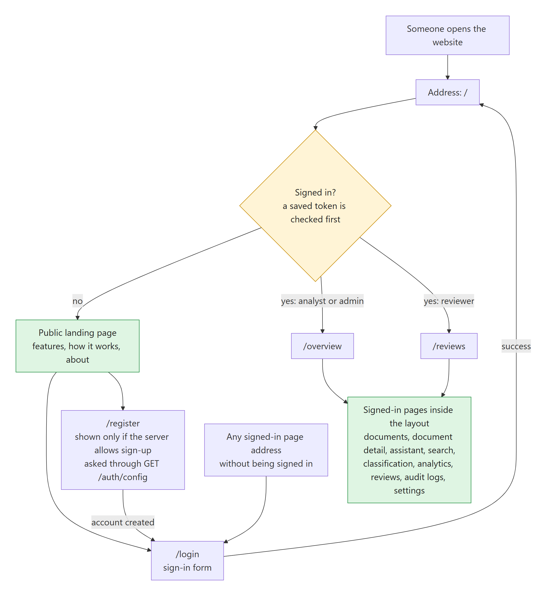

- A **visitor** who is not signed in opens `/` and sees the **public landing page**: what the product does, how it works, an illustration of an answer with its source (taken from the synthetic demo documents and labelled as an illustration), and a plain note that it is a prototype. From there they choose **Sign in** (`/login`) or, **only if the server allows sign-up**, **Create account** (`/register`). The page asks the server (`GET /api/v1/auth/config`) whether sign-up is open, so the button never promises something the server will refuse.
- A **signed-in user** who opens `/` is sent straight to their first page: `/overview` for analysts and administrators, `/reviews` for reviewers.
- Any signed-in page opened without signing in goes to `/login`.

**The signed-in pages** (the left menu; each item appears only if your role allows it):

| Page | What it is for |
|---|---|
| Overview | Counts of documents by status, processing success rate, category distribution, recent uploads, searches and questions. Refreshes every 8 seconds |
| Documents | Upload (click or drag and drop), see each file's processing status live, filter by file name, status and file type, open, delete |
| Document detail | Extracted text preview, predicted and human-verified category with scores, detected entities, the step-by-step processing history, and buttons: download, reprocess, reclassify, delete |
| AI Assistant | Ask questions, see the answer appear word by word, open the cited passages, give thumbs up or down, keep a list of your past conversations |
| Semantic Search | Keyword, semantic or hybrid search with filters, highlighted words and a score per result |
| Classification | The active model, its test metrics, a confusion matrix, a "try some text" box, and (administrators) a **Train on synthetic data** button |
| Analytics | Upload trends, file types, category mix, search usage, the classifier comparison and the latest offline retrieval evaluation, each panel labelled *measured*, *offline evaluation* or *synthetic* |
| Review Queue | Low-confidence predictions waiting for a human: confirm or correct, with a note; review history |
| Audit Logs | Who did what, when, with what outcome (administrators) |
| Settings | Status of Ollama, the language model, the embedding model and the classifier; user list and role changes (administrators) |

The interface has a dark and a light theme (remembered per browser), works on a phone-sized screen, and shows an honest "System online / degraded" light in the top bar.

---

## 5. Data flow 1: signing in and every request

### Signing in

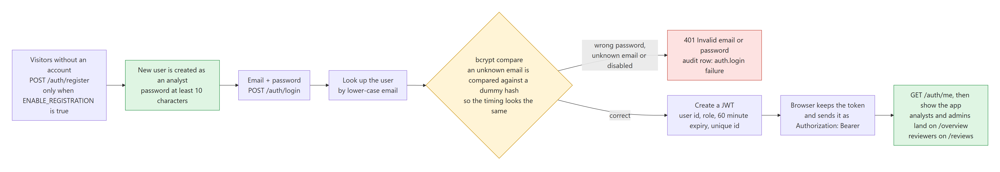

1. The browser sends email and password to `POST /auth/login`.
2. The server looks the user up by lower-case email and compares the password with the stored **bcrypt** hash. If the email does not exist it still compares against a dummy hash, so a wrong email and a wrong password take the same time.
3. On failure: `401 Invalid email or password`, and an audit row is written. The same message is used for every failure.
4. On success the server creates a **JWT** (signed with `JWT_SECRET`, algorithm HS256) containing the user id, the role, an expiry 60 minutes ahead and a unique id.
5. The browser stores the token (in `localStorage`; see the security notes for the trade-off) and sends it as `Authorization: Bearer <token>` on every later request. It then calls `GET /auth/me` to learn who it is.
6. Self-registration (`POST /auth/register`) works only when `ENABLE_REGISTRATION=true`; it always creates an *analyst* and needs a password of at least 10 characters.

### Every request after that

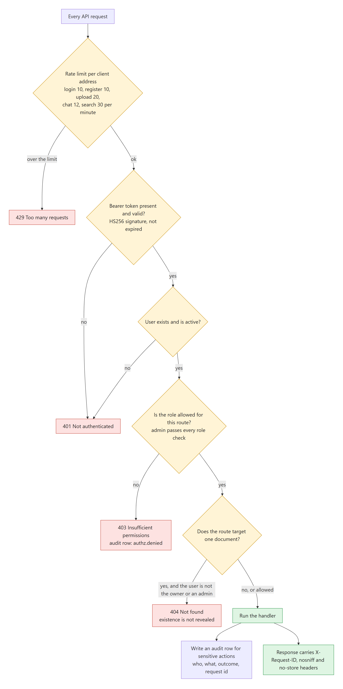

The order matters: **rate limit → valid token → active user → role allowed → ownership of the specific document → handler → audit row**. Each failure has its own answer (429, 401, 403 with an audit row, 404). Every response also carries a request id (`X-Request-ID`) that appears in the audit log and in error messages, so a problem report can be traced.

Rate limits are per client address, per minute: login 10, register 10, upload 20, chat 12, search 30 (the default). The limiter lives in the server's memory, so it suits one server only.

---

## 6. Data flow 2: uploading and processing a document

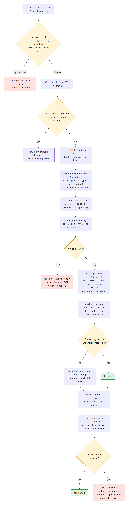

### Step A: the upload request (fast, happens while the user waits)

`POST /documents` accepts up to 20 files at once. For each file the API:

1. **Validates** it: not empty; within the size limit (25 MB by default, read in a bounded way so a huge file is never fully loaded); extension in the allow-list (`pdf, docx, xlsx, txt, csv`); the declared content type matches the extension; and the **real structure** is right (a PDF must start with `%PDF-`; a DOCX or XLSX must be a valid zip with the expected members and must not expand beyond 200 MB; text and CSV must be valid UTF-8 without binary bytes). A file that fails is refused with a clear message and the failure is audited. One bad file does not stop the others.
2. Computes its **SHA-256** fingerprint. If the same owner already has a document with that fingerprint, the existing document is returned and marked `duplicate`; nothing new is stored.
3. Saves the file under a **random name** (the original file name is kept only as a label and is never used to build a path; a second path check guards against traversal).
4. Inserts a `documents` row (status `uploaded`) and a `processing_jobs` row (status `pending`), and sets the status to `queued`.

### Step B: the worker (slow, happens in the background)

A worker loop (inside the API process, or the separate `worker` container) repeatedly **claims** a pending job with a single atomic `UPDATE … WHERE status='pending'`. If two workers race, only one wins, so a document is never processed twice at once. Then, with every step recorded in `processing_events` (that is the history shown on the document page):

| Status | What happens |
|---|---|
| `extracting` | Text is read from the file (PDF page by page; DOCX paragraphs and tables; XLSX each sheet as "Sheet: name" plus rows; CSV rows joined with `|`), then cleaned (Unicode normalised, control characters and extra whitespace removed). No text at all fails the document with a message (scanned files need OCR, which is **not implemented**). |
| `chunking` | The text is cut into passages of about **900 characters** with **120 characters of overlap**, preferring paragraph and sentence boundaries, never crossing a page. Chunk rows are saved in SQL; any older chunks of this document are replaced first. |
| `embedding` | Each chunk is turned into a vector and stored in Qdrant. The document's old vectors are deleted first, so re-running never duplicates anything. The vector's id equals the chunk's id. |
| `indexed` | The vectors are stored. |
| `classifying` | The classifier predicts a category from the first 20,000 characters (see section 7). If no model is trained, or its file is missing on this server, classification is skipped and the history says so. |
| entities | Dates, money, times and emails are found (plus people, organisations and places if the optional spaCy model is installed). |
| `completed` | All stages are done. |

**If embedding or Qdrant is unavailable**, the pipeline does not stop: the text is still extracted, chunked, classified and keyword-searchable. At the end the document is marked `failed` with an explicit message ("semantic indexing incomplete") and the job is retried up to 3 times (`MAX_JOB_ATTEMPTS`), or you can press **Reprocess**.

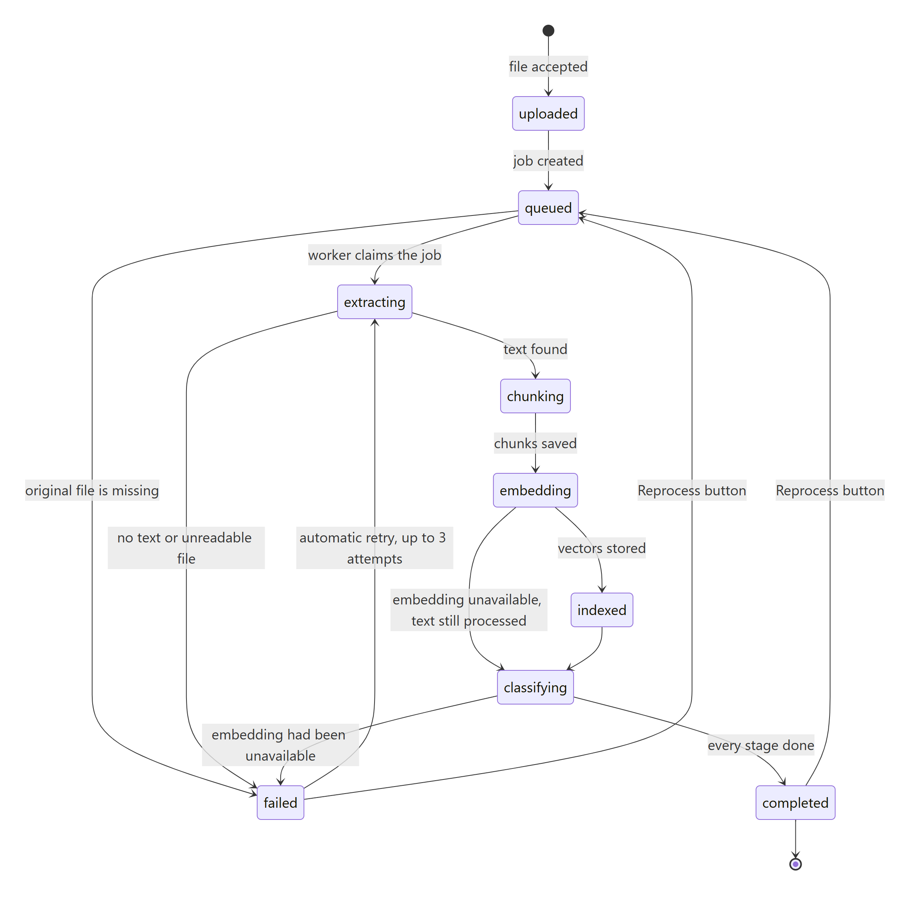

**Reprocess** needs the original file. If it is gone (this happens on the free hosting, whose disk is wiped on restart) the API answers `409 file_missing` *before* touching the document, so its text and search entries stay intact.

### Keeping the SQL database and Qdrant in step

They cannot be changed in one atomic operation, so there are rules instead: the chunk rows in SQL are the **source of truth**; vectors are derived and keyed by chunk id; re-processing replaces vectors; and the command `python -m app.cli reindex` (also run at start-up when `AUTO_REINDEX=true`) **rebuilds all vectors from the chunk text stored in SQL**. **Deleting** a document removes vectors, then the file, then the database rows; if a step fails the document stays, flagged `delete_failed`, so the problem is visible and the delete can be retried. Qdrant collections are named after the embedding model and size (`infomind_chunks_<model>_<dimensions>`), so vectors from different models never mix; changing the model means reprocessing the documents.

---

## 7. Data flow 3: classification and human review

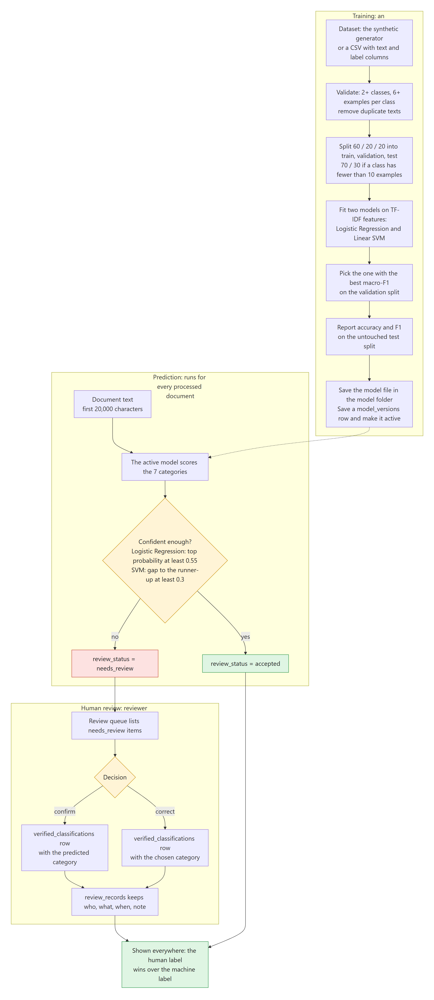

### Training (an administrator action; never automatic)
- **Data:** the built-in synthetic generator (7 categories, 60 templated documents each) or an uploaded CSV with `text` and `label` columns.
- **Checks:** at least 2 classes, at least 6 examples per class, duplicate texts removed, and training aborts if the same text lands in two splits.
- **Method:** a stratified **60 / 20 / 20** split (train / validation / test; 70 / 30 if any class has fewer than 10 examples). Two models are fitted on **TF-IDF** features (1–2-word phrases, English stop-words removed): **Logistic Regression** and **Linear SVM**. The one with the better **macro-F1 on the validation split** is chosen. The numbers reported to users come from the **untouched test split**.
- **Result:** a `.joblib` model file in the model folder and a `model_versions` row marked active. Old versions are kept, only one is active.
- **Honest caveat built into the app:** the bundled data is generated from templates, so scores are near-perfect and say almost nothing about real-world accuracy. The Classification and Analytics pages label this.

The seven default categories are *Technical Documentation, Research and Reports, Administration, Policies and Procedures, Finance and Procurement, Training and Education, General Correspondence*. They are illustrative topics, not security classifications.

### Predicting
Each processed document gets a prediction: a category, a score and all scores. Logistic Regression scores are **uncalibrated probabilities**; SVM scores are **decision values** and are never shown as probabilities. A prediction is **low confidence** if the top probability is under 0.55 (Logistic Regression) or the gap to the runner-up is under 0.3 (SVM, a heuristic). Low confidence → `needs_review`; otherwise `accepted`.

### Review
Reviewers (and admins) see the queue of `needs_review` items with a text preview. They **confirm** the predicted category or **correct** it to another valid one, with an optional note. This writes a `verified_classifications` row (one per document) and a `review_records` row (who, what, when). **Human labels are stored separately and are never overwritten by the model**, even when a document is reclassified later. Everywhere a category is shown or filtered, the **human label wins** over the machine label. Retraining is a separate, explicit act; reviews are not silently fed back into training.

---

## 8. Data flow 4: searching

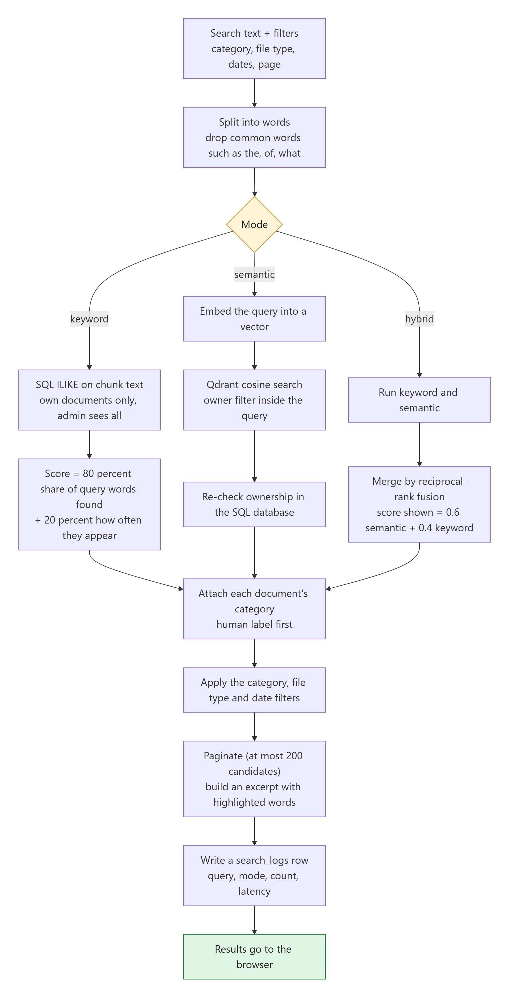

Three modes, one results page:

- **Keyword:** the query is split into words (common words like "the", "what", "of" are dropped). Chunks containing any of the words are found with SQL `ILIKE` (the words are bound parameters, never pasted into SQL). Each chunk scores 80% for the share of query words it contains plus 20% for how often they appear.
- **Semantic:** the query is turned into a vector and compared with all chunk vectors in Qdrant by cosine similarity, with an owner filter inside the query; every hit is then re-checked against the SQL database for authorisation. This is what finds "rules about putting unauthorised programs on work computers" in an acceptable-use policy that never uses those words.
- **Hybrid:** both run, and the two ranked lists are merged with **reciprocal-rank fusion**; the score shown is 0.6 × semantic + 0.4 × keyword.

Then: each result gets its document's category (human label first), the category, file-type and date filters are applied, results are paginated (at most 200 candidates are considered), an excerpt with the matching words highlighted is built, and a `search_logs` row (query, mode, count, latency) feeds the analytics.

Measured limits (details in [EVALUATION.md](EVALUATION.md)): on the small labelled set all three modes tie because the queries share words with their documents; on three paraphrase queries semantic search clearly helped, and hybrid fusion once ranked a weak keyword hit above the correct semantic hit. If the embedding or vector service is down, search degrades and says so.

---

## 9. Data flow 5: the AI assistant (answers with citations)

### The decision flow

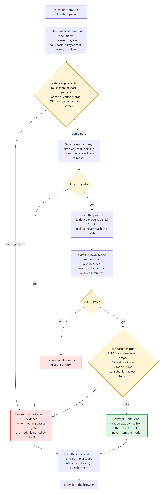

This is **RAG** (retrieval-augmented generation): first *retrieve* relevant passages, then ask the language model to answer *only from them*. The system is built so that a wrong or empty answer is replaced by a refusal, never by something invented.

1. **Retrieve** with hybrid search over the documents this user may see (keyword only, with a note, if the vector service is down).
2. **Evidence gate:** a chunk counts only if it contains at least 34% of the question's words **or** has a semantic score of at least 0.55. If nothing passes, the fixed reply "The available documents do not contain sufficient evidence to answer this question reliably." is returned and **the language model is not called at all**.
3. **Sanitise:** control characters and delimiter-like tokens are stripped; chunks that match prompt-injection patterns ("ignore all previous instructions", fake system tags, "reveal the system prompt"…) are **dropped entirely** and counted (the user is told how many were excluded). At most 5 chunks remain.
4. **Prompt:** the chunks go in as numbered, delimited data blocks **E1…E5**; real ids never reach the model. The system prompt says the blocks are untrusted data, to use only them, to cite aliases, to mark inferences, and to set `supported:false` if the evidence does not answer.
5. **Model call:** Ollama in JSON mode, temperature 0, keys requested in the order `supported, citations, answer, inference`.
6. **Validate (the only place a reply becomes an answer):** it must be valid JSON; `supported` must be true; the answer must not be empty; and at least one citation must map to a chunk that was actually retrieved. Citation text shown to the user is taken from the **stored chunk**, never from the model's output. Anything else becomes the refusal.
7. **Save** the conversation and both messages, and write an audit row (outcome flag only, **not** the question text).

The model has no tools, no network and no shell. The layered defences are listed at the top of `backend/app/services/rag_service.py`; none is claimed to be sufficient alone.

### The live stream

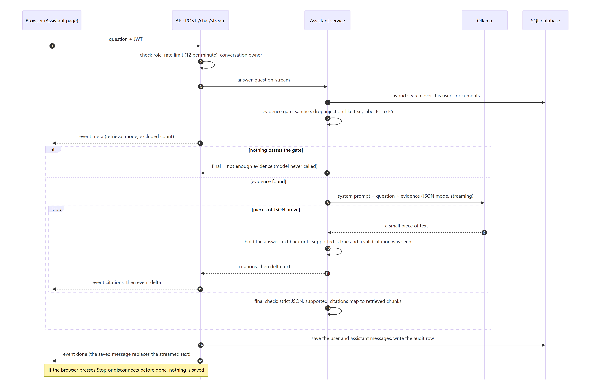

The Assistant page uses `POST /chat/stream`, which sends Server-Sent Events: **`meta`** (retrieval mode, excluded count), **`citations`**, **`delta`** (text pieces), then **`done`** (the saved message) or **`error`**. Because the model writes `supported` and `citations` *before* `answer`, a small stream parser (`AnswerStream`) can **hold the answer text back until it has seen `supported: true` and a valid citation**; only then do words appear. The text that streams is provisional: the `done` event carries the message that went through the full validation and was saved, and it replaces the streamed text. If you press **Stop** or the connection drops before `done`, **nothing is saved**. The browser reads the stream with `fetch` (not `EventSource`, because `EventSource` cannot send the auth header).

### What was measured
With the default `llama3.2:3b`, the assistant sometimes wrongly **refuses** an answerable question when a second, less relevant chunk is also retrieved (0 of 5 on one such question). That failure is in the safe direction, but it makes the assistant look broken. With `llama3.1:8b` the same question was answered 10 of 10 times, and the official evaluation scored 4/4 answerable answered and 3/3 unanswerable refused, with every citation valid. This is a 7-question test on 14 synthetic documents: it shows the pipeline works, not that answers are reliable in general, and **no manual faithfulness review of the answers has been done**.

---

## 10. Entities, analytics, audit and evaluation

- **Entities:** rules find dates, money amounts, times and emails in every chunk; if the optional spaCy English model is installed it also finds people, organisations, places and more. Results are heuristic and contain errors, so a reviewer can **remove** a wrong one (it is flagged `removed`, not deleted).
- **Analytics:** all numbers come from stored records. Each panel is tagged *measured*, *offline evaluation* or *synthetic*; classification metrics always say they come from an offline test on the training data's held-out split.
- **Audit log:** an append-only list (the application has no update or delete path for it; this is **not** enforced by database privileges). It records sign-in successes and failures, registration, upload, download, delete, reprocess, reclassify, review, role changes, training, denied requests and assistant questions, each with actor, outcome and request id. It never stores passwords, tokens or document content. Viewing a document is not audited.
- **Evaluation command:** `python -m app.cli evaluate [--skip-rag]` retrains on the synthetic set and reports classification metrics for both models; runs 14 labelled queries in all three search modes (Recall@3, Precision@3, MRR, nDCG@3); and, if Ollama is running, asks 7 questions (4 answerable, 3 not). It writes JSON and CSV files to `data/evaluation/`, stores the runs in `evaluation_runs`, and leaves a `manual_faithfulness_review: PENDING` mark on every RAG row because a human, not another model, has to judge faithfulness.

---

## 11. The database

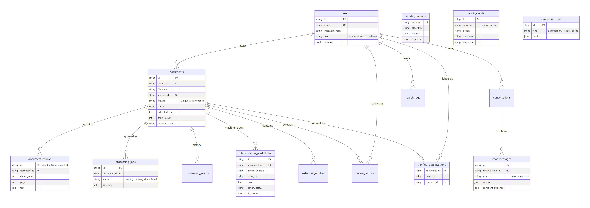

15 application tables (plus Alembic's own version table, 16 in the database). IDs are string UUIDs so the same schema works on PostgreSQL and SQLite. The schema is created by Alembic migration `0001_initial_schema` in production and by `create_all` in development and tests.

| Table | Holds |
|---|---|
| `users` | Email (unique), bcrypt hash, role, active flag |
| `documents` | One row per uploaded file: owner, name, random `storage_id`, type, size, SHA-256 (unique per owner), status, error message, the full extracted text, page and chunk counts, demo flag, deletion state |
| `document_chunks` | The passages; `id` is also the Qdrant point id; unique per `(document, chunk_index)` |
| `processing_jobs` | The queue: pending, running, done or failed; attempts; duration |
| `processing_events` | The visible step-by-step history of each document |
| `model_versions` | Each trained classifier: algorithm, categories, metrics, both models' comparison, dataset info, score type, which one is active |
| `classification_predictions` | Machine output: category, score, all scores, `is_current`, review status |
| `verified_classifications` | The human label (one per document) |
| `review_records` | Every review decision with who, what, when and a note |
| `extracted_entities` | Entities with label, method (rule or spacy) and a removed flag |
| `conversations`, `chat_messages` | Private chats; assistant messages keep their citations, whether evidence was sufficient, latency and feedback |
| `audit_events` | The audit trail |
| `search_logs` | One row per search, for analytics |
| `evaluation_runs` | Stored evaluation results |

Deleting a document cascades to its chunks, jobs, events, entities and reviews; predictions and the verified label are removed explicitly.

---

## 12. The API at a glance

Base path `/api/v1`; every route is under it. In production there is no `/docs` and no `/openapi.json`; locally `http://localhost:8000/docs` shows the live, authoritative list. Errors have one shape: `{"error": {"code", "message", "request_id", "details?"}}`. The full table with roles is in [API.md](API.md).

| Area | Routes |
|---|---|
| Health | `GET /health`, `GET /health/ready` (database, vector store, Ollama), `GET /system/models` |
| Auth | `GET /auth/config` (public), `POST /auth/register`, `POST /auth/login`, `POST /auth/logout`, `GET /auth/me`, `GET /users`, `PATCH /users/{id}/role` |
| Documents | `POST /documents`, `GET /documents`, `GET /documents/{id}`, `…/content`, `…/download`, `POST …/reprocess`, `POST …/reclassify`, `DELETE /documents/{id}`, `DELETE …/entities/{entity_id}` |
| Search | `GET /search` (keyword), `POST /search/semantic`, `POST /search/hybrid` |
| Assistant | `POST /chat`, `POST /chat/stream`, `GET /conversations`, `GET /conversations/{id}`, `DELETE /conversations/{id}`, `POST /messages/{id}/feedback` |
| Classification | `POST /classification/predict`, `GET /classification/models`, `GET /classification/metrics`, `POST /classification/train` |
| Review | `GET /reviews`, `POST /reviews/{document_id}`, `GET /reviews/history` |
| Insight | `GET /analytics/overview`, `/analytics/documents`, `/analytics/classification`, `/analytics/search`, `GET /audit`, `GET /evaluations` |

---

## 13. The frontend in detail

- **Structure:** `frontend/src/features/<page>/` holds one folder per page; `components/` holds the shared layout and building blocks (`Layout`, `ui`, `ConfusionMatrix`); `lib/` holds the API client (`api.ts`), the sign-in state (`auth.tsx`), the theme switch and helpers; `types/` mirrors the API's data shapes.
- **Routing and guards:** `App.tsx` defines the routes. A `Guard` sends visitors to `/login` and sends users without the right role to a page they may see. The `Home` component decides what `/` shows (section 4). This is a convenience only; **the server enforces every permission**.
- **Talking to the server:** one `request()` function adds the token, turns error responses into readable messages with the request id, and signs the user out on a 401. The API address comes from `VITE_API_BASE` (set at build time; empty means the same origin, with the dev server proxying `/api`).
- **Live data without a push channel:** pages poll while something is happening: the top bar every 5 seconds, the overview every 8, the document list every 2.5 seconds *only while a document is still processing*, and a document page every 2 seconds until it finishes. Only the assistant streams.
- **Uploads** use `XMLHttpRequest` so a progress bar is possible; **downloads** fetch with the token and save the blob.
- **Assistant:** reads the event stream, shows words as they arrive, supports Stop, and swaps in the saved message on `done`.
- **Accessibility and polish:** labelled form fields, visible focus rings, reduced-motion support, dark and light themes.

---

## 14. Security design

| Area | What is in place |
|---|---|
| Passwords and tokens | bcrypt hashing; JWT with expiry; same message and similar timing for unknown email and wrong password; login and register rate limits |
| Authorisation | Role checks in server dependencies; owner-or-admin document access with 404; private conversations; admin-only training, users, audit |
| Uploads | Extension allow-list, MIME check, structure check, size cap, zip-expansion cap, random storage names, path guard, files stored outside any served folder, `nosniff` on download. Files are only ever parsed, never executed |
| Database | Parameterised queries only |
| Assistant | Scoped retrieval, injection filtering, delimited data blocks, JSON-only output, validated citations, evidence gate; no tools or network for the model |
| Audit | Security-relevant actions recorded with actor, outcome and request id; no secrets or content |
| Secrets and configuration | `.env` is never committed (only `.env.example` placeholders); production refuses a default or short `JWT_SECRET`; docs UI and OpenAPI schema are off in production; self-registration can be switched off; the container drops root after fixing data-folder ownership; CORS allows only named origins and no credentials |

**Known weaknesses, stated plainly** (full list in [SECURITY.md](SECURITY.md)): the token sits in `localStorage` (a script-injection bug could steal it) and cannot be revoked before it expires; the rate limiter is per-process and per-address with no account lockout; prompt-injection defences reduce but cannot remove the risk, and can exclude harmless text; there is no malware scanning, no encryption at rest and no TLS in the bundled local setup; administrators see all documents; model files are unpickled on load, so only files produced by this app's own training may be placed in the model folder. **A short, guessable administrator password on a public site is a real risk**: use a long one for anything beyond a demo.

---

## 15. Configuration

All settings are environment variables (a `.env` file locally). Placeholders are in [../.env.example](../.env.example) and [../backend/.env.example](../backend/.env.example). The ones that matter most:

| Setting | Default | Meaning |
|---|---|---|
| `ENVIRONMENT` | `development` | `production` hides the docs, requires a strong `JWT_SECRET`, and expects Alembic to manage the schema |
| `DATABASE_URL` | SQLite file | `postgresql+psycopg://…`; `postgres://` and `postgresql://` URLs are converted automatically |
| `QDRANT_URL` | `http://localhost:6333` | A server address, `:memory:`, or `path:<folder>` for embedded mode (single process only) |
| `JWT_SECRET` | placeholder | Must be random and 32+ characters in production |
| `ENABLE_REGISTRATION` | `true` | `false` closes self-sign-up (the landing page then hides "Create account") |
| `INITIAL_ADMIN_EMAIL` / `INITIAL_ADMIN_PASSWORD` | none | Create the first administrator at start-up (password at least 10 characters) |
| `RESET_ADMIN_PASSWORD` | `false` | One-shot: set the existing admin's password to `INITIAL_ADMIN_PASSWORD`, then switch back to `false` |
| `OLLAMA_BASE_URL`, `OLLAMA_LLM_MODEL`, `OLLAMA_EMBEDDING_MODEL` | `localhost:11434`, `llama3.2:3b`, `nomic-embed-text` | The local models; nothing is downloaded automatically |
| `EMBEDDING_PROVIDER`, `EMBEDDING_DIMENSIONS` | `ollama`, `768` | `hash` selects a lexical CPU-only embedder (for development, tests and the free hosting) |
| `MAX_UPLOAD_MB`, `CHUNK_SIZE_CHARS`, `CHUNK_OVERLAP_CHARS` | `25`, `900`, `120` | Upload limit and chunking |
| `RUN_WORKER_IN_API`, `MAX_JOB_ATTEMPTS` | `true`, `3` | Where the worker runs; retry limit |
| `LOW_CONFIDENCE_THRESHOLD`, `MIN_KEYWORD_OVERLAP`, `MIN_SEMANTIC_SCORE`, `RAG_TOP_K` | `0.55`, `0.34`, `0.55`, `5` | Review routing and the evidence gate |
| `CORS_ORIGINS` | `http://localhost:5173` | Allowed web origins |
| `AUTO_TRAIN`, `AUTO_REINDEX`, `SEED_DEMO` | hosting only | Start-up conveniences used by `start.sh` |

---

## 16. Running it: locally, in Docker, and live

### Start-up sequence of the server container

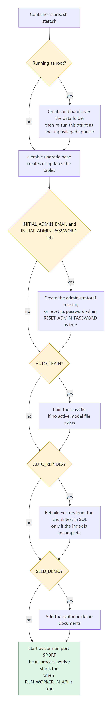

### Where it runs

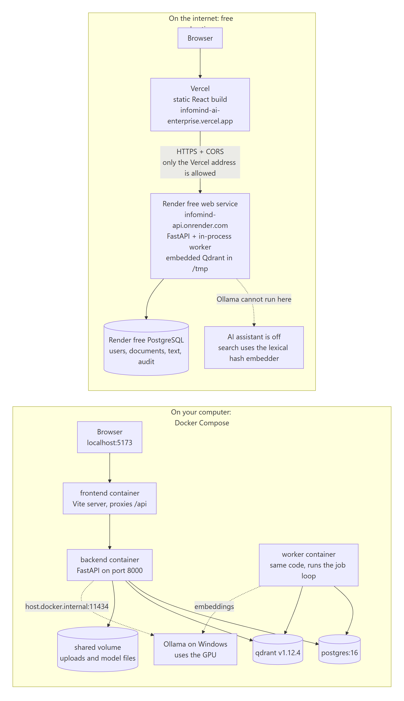

**Locally without Docker** (no Ollama needed to try it): `scripts\setup.ps1`, edit `backend\.env`, then `alembic upgrade head`, `python -m app.cli train`, `create-admin`, `seed-demo`, and `scripts\dev.ps1` (API on port 8000, web app on 5173). **With Docker:** `docker compose up --build -d` starts PostgreSQL, Qdrant, the API, the worker and the web app; Ollama stays on Windows so it can use the GPU, and the containers reach it at `host.docker.internal:11434`. Exact commands are in [../README.md](../README.md).

**Command-line tools** (`python -m app.cli …`): `init-db`, `create-admin`, `train [--if-missing]`, `reindex [--if-needed]`, `seed-demo`, `export-data`, `evaluate`.

**The live copy** (free plans):
- Web app: <https://infomind-ai-enterprise.vercel.app> (Vercel; redeploys on every push to `main`).
- API: <https://infomind-api.onrender.com> (Render free web service, with a free PostgreSQL).
- The administrator's email is `admin@example.com`; its password is whatever `INITIAL_ADMIN_PASSWORD` was set to on Render (it is deliberately not written in any file in this repository).
- Self-registration is currently **off** on the live site (`ENABLE_REGISTRATION=false`), so the landing page shows only "Sign in".

**What the free plan means in practice:**

| Fact | Consequence |
|---|---|
| The API sleeps after about 15 minutes without traffic and takes about a minute to wake | The first visit after a pause is slow |
| Ollama cannot run on Render | The AI assistant is off there ("Ollama is not reachable"), and search uses the lexical hash embedder |
| The disk is wiped on every restart | Original uploaded files and the trained model file are lost; the model is retrained at start-up (one extra model version each time); the vector index is rebuilt from the chunk text in the database |
| The database lives in Render's free PostgreSQL | Users, documents' text, labels, reviews, entities, analytics, audit and chats survive restarts |
| The free database expires **2026-11-27** (then a 14-day grace period, then deletion, no backups) | After that the API cannot start until a new database is created or the plan is upgraded; see [DEPLOYMENT.md](DEPLOYMENT.md) |

---

## 17. Tests and what has been verified

Run on this machine on 2026-10-29:

| Suite | Result |
|---|---|
| Backend: `ruff` + `pytest` | lint clean; **91 passed** |
| Frontend: `tsc` + `vitest` | type-check clean; **36 passed** |

The backend tests use SQLite, an in-memory Qdrant, the hashing embedder and a scripted fake language model, so they need no downloads. They cover sign-in and roles, upload validation, the pipeline, deduplication, search, the assistant's gates and citation validation, streaming, deployment bootstrap commands, evaluation and extraction. The frontend tests cover pages, the streaming reader and the website routing.

Also verified earlier (see the README for the dated details): the full Docker stack with PostgreSQL, a headless-browser walkthrough of every page against it, the streaming assistant with a real model, and the live Render and Vercel deployment including a real restart of the API.

**Not verified:** a native Windows PostgreSQL install, OCR (not built), browsers other than headless Edge, load testing, security testing, the assistant behind a production reverse proxy, and manual faithfulness of the assistant's answers.

---

## 18. Known limitations

- **No OCR**: scanned PDFs fail with a clear message.
- The AI assistant is **off on the live site**; with the small default model it can wrongly refuse some answerable questions (measured; the larger model did not on the test set).
- Keyword search is SQL `LIKE` plus word overlap, not BM25; hybrid rank fusion can mis-rank; search totals are capped at 200 candidates.
- Each assistant question is independent (no memory of earlier turns); stopping or losing the connection mid-answer saves nothing.
- Only the assistant streams; other pages poll.
- The in-memory rate limiter suits one server; JWT in browser storage; no malware scanning; no per-document sharing.
- Metrics from the bundled data are synthetic and near-perfect; they demonstrate the pipeline, not real-world accuracy.
- Free hosting: sleeping API, lost files on restart, database expiry (section 16).

**Ideas for later:** OCR with Tesseract, server-pushed status events, BM25 or a reranker, Redis-backed rate limits, cookie-based sessions, an entity relationship graph, scheduled retraining with approval, per-document sharing.

---

## 19. Where to find things in the code

| I want to understand… | Look at |
|---|---|
| How the server starts, middleware, CORS, error shape | `backend/app/main.py`, `core/errors.py` |
| Settings and their defaults | `backend/app/core/config.py` |
| Passwords and tokens | `backend/app/core/security.py`; role and ownership checks in `api/deps.py` |
| Route handlers | `backend/app/api/v1/` (`auth, documents, search, chat, classification, system`) |
| Upload checks, text extraction, chunking | `backend/app/services/extraction_service.py` |
| The processing pipeline, job queue, deletion, vector rebuild | `backend/app/services/document_service.py`; worker loop in `backend/app/workers/worker.py` |
| Search | `backend/app/services/retrieval_service.py`; vectors in `vector_store.py` |
| Calls to Ollama and the hashing embedder | `backend/app/services/embedding_service.py` |
| The assistant | `backend/app/services/rag_service.py` |
| Classifier training and prediction | `backend/app/ml/training.py`, `ml/synthetic.py`; `services/classification_service.py` |
| Entities | `backend/app/services/entity_service.py` |
| Analytics and audit | `backend/app/services/analytics_service.py`, `audit_service.py` |
| Evaluation | `backend/app/evaluation.py`, `ml/demo_corpus.py` |
| Tables | `backend/app/models/__init__.py`; migration in `backend/alembic/versions/` |
| Command-line tools | `backend/app/cli.py`; container start-up in `backend/start.sh` |
| Screens | `frontend/src/features/*`; routes in `frontend/src/App.tsx`; API client in `frontend/src/lib/api.ts` |
| Hosting | `render.yaml`, `render.paid.yaml`, `frontend/vercel.json`, `docker-compose.yml`, [DEPLOYMENT.md](DEPLOYMENT.md) |
| Other documents | [ARCHITECTURE.md](ARCHITECTURE.md), [API.md](API.md), [SECURITY.md](SECURITY.md), [EVALUATION.md](EVALUATION.md), [MODEL_CARD.md](MODEL_CARD.md), [TROUBLESHOOTING.md](TROUBLESHOOTING.md) |

---

## 20. Glossary

- **API:** the part of the server that the web app calls to read and change data.
- **Audit log:** a permanent record of who did what.
- **bcrypt:** a deliberately slow way of storing passwords so they cannot be read back.
- **Chunk:** a short passage of a document (about 900 characters) that is stored, indexed and searched on its own.
- **Classification:** automatically choosing a category for a document.
- **Confusion matrix:** a table showing which categories the model mixes up.
- **Cosine similarity:** a score for how close the meanings of two pieces of text are, using their vectors.
- **Embedding / vector:** a list of numbers that captures the meaning of a text, so similar meanings are close together.
- **Evidence gate:** the check that stops the assistant from calling the language model when the documents hold nothing relevant.
- **JWT:** a signed token that proves who you are for a limited time.
- **Macro-F1:** a score (0 to 1) of how well a classifier does across all categories, counting each category equally.
- **Ollama:** a program that runs language models on your own computer.
- **Prompt injection:** text inside a document that tries to give orders to the language model; the system filters it out.
- **Qdrant:** a database specialised in finding the vectors closest to a query vector.
- **RAG (retrieval-augmented generation):** find relevant passages first, then let a language model answer using only those.
- **Reciprocal-rank fusion:** a way of merging two ranked result lists by position.
- **RBAC (role-based access control):** permissions that depend on a user's role.
- **SSE (Server-Sent Events):** a way for the server to send a response in pieces over one connection; used to show assistant answers live.
- **TF-IDF:** a way of turning text into numbers by weighting words that are frequent in a document but rare overall.
- **Worker:** a background process that does slow jobs, such as processing uploads.
